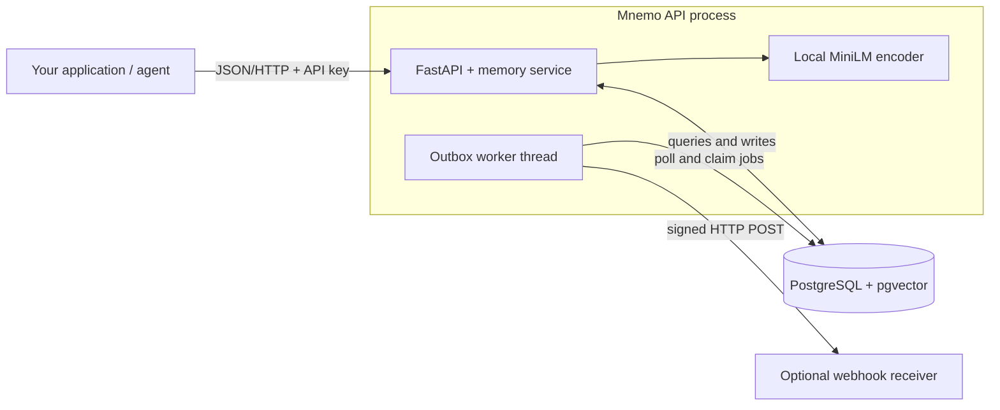

# Mnemo

**An inspectable memory API for AI agents.** Store application-supplied facts,
retrieve context with local embeddings, and review possible conflicts when facts
change. Built with FastAPI, PostgreSQL + pgvector and a typed Python SDK.

[Get started](#quickstart) · [Documentation](docs/README.md) · [Python SDK](sdk/README.md) · [Architecture](docs/architecture.md)


**Status:** early, single-tenant prototype. The web playground is a browser
simulation. Run the API for real MiniLM embeddings and PostgreSQL persistence.

## What it does

- **Store and retrieve facts.** Keep text, vectors, tags, importance and optional
  expiry together in one database. Embeddings use pretrained `all-MiniLM-L6-v2`
  locally, with 384 dimensions.
- **Inspect retrieval policy.** Vector candidates receive age and importance
  weights, a default keyword boost, and optional diversity selection. Responses
  expose the memory, similarity, final score and age.
- **Review possible conflicts.** A default English negation heuristic flags
  nearby statements for explicit resolution. Keeping one fact makes the other
  inactive; the row remains available for inspection.
- **Integrate through an API.** Scoped keys, cursor pagination, export/import,
  audit events and a transactional outbox support the service. Optional webhook
  delivery uses signatures, stable event IDs and bounded retries.

Your application supplies facts and generates answers. Mnemo provides memory
storage, retrieval and conflict review.

## Quickstart

Requires Git, Docker and Docker Compose. From this checkout:

```bash
cd backend
docker compose up --build
```

This starts PostgreSQL + pgvector and the API, applying migrations on boot.
In another terminal:

```bash
curl -sS http://localhost:8000/health
# {"status":"ok"}

curl -sS http://localhost:8000/v1/memories \
  -H 'X-API-Key: dev-local-key-change-me' \
  -H 'Content-Type: application/json' \
  -d '{"namespace":"demo","content":"Pranav lives in Bengaluru","importance":3}'

curl -sS http://localhost:8000/v1/memories/search \
  -H 'X-API-Key: dev-local-key-change-me' \
  -H 'Content-Type: application/json' \
  -d '{"namespace":"demo","query":"Where does Pranav live?","limit":3}'
```

The first memory request loads the embedding model and may take longer. The
local development key above must match your deployment's `MNEMO_API_KEY`.
Interactive backend documentation is at `http://localhost:8000/docs`.

For the Python client, use Python 3.12+ and install from the repository root in
your Python environment:

```bash
pip install -e ./sdk
```

```python
from mnemo import MnemoClient

with MnemoClient(
    base_url="http://localhost:8000",
    api_key="dev-local-key-change-me",
    default_namespace="demo",
) as client:
    memory, conflicts = client.add_memory("This project uses PostgreSQL")
    for hit in client.search("Which database does this project use?").hits:
        print(hit.memory.content, hit.relevance_score)
```

See [deployment and configuration](docs/deployment.md) for an existing database,
configuration variables, operational commands and integration-test setup.

## Architecture



The Next.js site runs separately; its demos do not send API or model requests.
The [system design](docs/architecture.md) explains process boundaries, ranking,
conflict checks, concurrency and the data model. The
[API reference](docs/api.md) covers operation scopes and contracts. A schema
snapshot used by the web reference lives in [frontend/public/openapi.json](frontend/public/openapi.json).

## Evaluation

The checked-in local run compares **60 memories and 50 hand-labelled queries**.
Raw cosine performs best on this dataset:

| Retrieval policy | Top-1 | Top-3 | MRR |
| --- | ---: | ---: | ---: |
| Raw cosine baseline | 74.0% | 94.0% | 0.841 |
| Decay + importance | 72.0% | 92.0% | 0.824 |
| Default keyword boost | 70.0% | 90.0% | 0.809 |

Source: [results, settings and environment](frontend/public/benchmark-results.json).
This in-sample comparison does not establish agent answer quality, conflict
precision/recall or production-scale performance. Additional ranking signals
have no demonstrated retrieval gain on this run. The
[benchmark runner](backend/benchmark/README.md) documents reproduction.

## Frontend development

With Node.js 20+ and pnpm 9 (the CI toolchain), run from the repository root:

```bash
cd frontend
pnpm install
pnpm dev          # http://localhost:3005
pnpm typecheck
pnpm test:e2e
pnpm build
```

The frontend has five landing sections, four docs pages and an interactive
recall/store/review playground. It works without a backend. Similarity in the
playground is a lexical approximation; the default view omits weak example
matches using a documented display cutoff.

[Frontend structure and maintenance](docs/frontend.md) · [Contributing and checks](CONTRIBUTING.md)

## Repository layout

```text
frontend/                Next.js app, dependencies, configuration and browser tests
  src/app/               routes and page metadata
  src/components/        layout / landing / docs / playground / shared UI
  src/hooks/             memory-store operations, keyboard tabs and scrolling
  src/lib/               memory simulation, API examples and site configuration
  public/                fonts, OpenAPI schema and saved benchmark
  tests/e2e/             browser regressions
backend/                 FastAPI, migrations, workers, benchmark and tests
sdk/                     typed sync/async Python client and client tests
scripts/                 shared schema export and documentation contract checks
docs/                    API, architecture, deployment and maintainer guides
  assets/                repository screenshots
  licenses/              third-party asset attribution
```

## Current boundaries

- Keys have operation scopes, but are not tenant-bound. Namespaces organize
  retrieval and do not provide tenant isolation.
- The default conflict detector is English-only and heuristic. It can miss
  changed numbers, dates and names, or flag statements that do not conflict.
- Soft deletion preserves a row; content updates replace text in place and do
  not create immutable versions of earlier content.
- The default encoder truncates beyond 256 word pieces. The service does not
  automatically chunk long documents.

[MIT license](LICENSE) · Built by [Pranav Gawai](https://pranavx.in)
