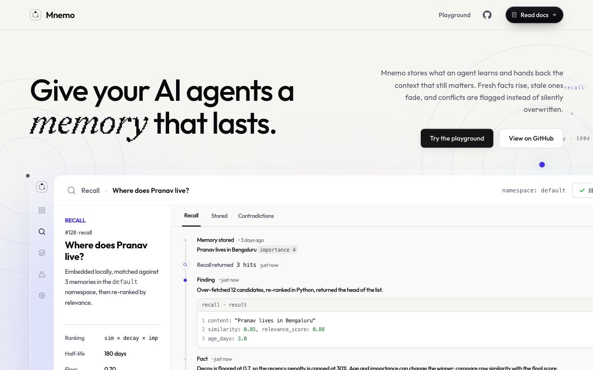
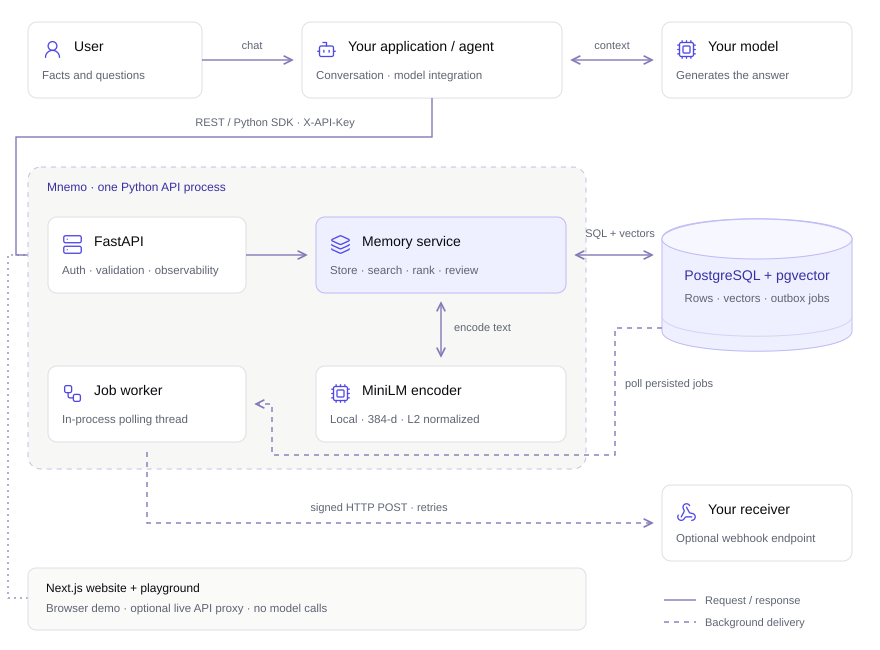

<div align="center">

<h1></h1>

<p><strong>An inspectable memory API for AI agents.</strong></p>

<p>
Store application-supplied facts, retrieve context with local embeddings,<br />
and review possible conflicts when facts change.
</p>

<p>FastAPI · PostgreSQL + pgvector · Typed Python SDK</p>

<p>
<a href="#quickstart">Get started</a> ·
<a href="docs/README.md">Documentation</a> ·
<a href="sdk/README.md">Python SDK</a> ·
<a href="docs/architecture.md">Architecture</a>
</p>

<a href="https://trymnemo.pranavx.in">

</a>

<p>
<strong>Early, single-tenant prototype.</strong><br />
The browser demo runs offline. Connect the optional Live API walkthrough for backend embeddings and PostgreSQL persistence.
</p>

</div>

## What it does

- **Store and retrieve facts.** Keep text, vectors, tags, importance and optional
  expiry together in one database. Embeddings use pretrained `all-MiniLM-L6-v2`
  locally, with 384 dimensions.
- **Inspect retrieval policy.** Vector candidates receive age and importance
  weights, a default keyword boost, and optional diversity selection. Responses
  expose the memory, similarity, final score and age.
- **Review possible conflicts.** English negation checks and narrow source-matched relocation/revision rules flag
  nearby statements for explicit resolution. Keeping one fact makes the other
  inactive; the row remains available for inspection.
- **Integrate through an API.** Scoped keys, cursor pagination, export/import,
  audit events and a transactional outbox support the service. Optional webhook
  delivery uses signatures, stable event IDs and bounded retries.
- **Build cited agent context.** A Python-owned context endpoint selects whole
  facts within a character budget, preserves source text and omits open conflicts
  by default. Sync/async SDK clients and provider-neutral tools consume it.
- **Restrict application access.** Issued keys support exact namespace grants
  and optional expiry. Restricted keys cannot use global admin operations.

Your application supplies facts and generates answers. Mnemo provides memory
storage, retrieval and conflict review.

## Quickstart

Requires Git, Docker and Docker Compose. From this checkout:

```bash
cd backend
docker compose up --build
```

This starts PostgreSQL + pgvector and the API, applying migrations on boot.
In another terminal:

```bash
curl -sS http://localhost:8000/health
# {"status":"ok"}

curl -sS http://localhost:8000/v1/memories \
  -H 'X-API-Key: dev-local-key-change-me' \
  -H 'Content-Type: application/json' \
  -d '{"namespace":"demo","content":"Pranav lives in Bengaluru","importance":3}'

curl -sS http://localhost:8000/v1/memories/search \
  -H 'X-API-Key: dev-local-key-change-me' \
  -H 'Content-Type: application/json' \
  -d '{"namespace":"demo","query":"Where does Pranav live?","limit":3}'
```

The first memory request loads the embedding model and may take longer. The
local development key above must match your deployment's `MNEMO_API_KEY`.
Interactive backend documentation is at `http://localhost:8000/docs`.

For the Python client, use Python 3.12+ and install from the repository root in
your Python environment:

```bash
pip install -e ./sdk
```

```python
from mnemo import MnemoClient

with MnemoClient(
    base_url="http://localhost:8000",
    api_key="dev-local-key-change-me",
    default_namespace="demo",
) as client:
    memory, conflicts = client.add_memory("This project uses PostgreSQL")
    for hit in client.search("Which database does this project use?").hits:
        print(hit.memory.content, hit.relevance_score)
```

See [deployment and configuration](docs/deployment.md) for an existing database,
configuration variables, operational commands and integration-test setup.

<h2 align="center">Architecture</h2>

<p align="center">
<a href="https://trymnemo.pranavx.in/docs/concepts#architecture">

</a>
</p>

<p align="center">
<a href="https://trymnemo.pranavx.in/docs/concepts#architecture">Explore the interactive system map and user flow</a>
</p>

The Next.js site runs separately. Its Browser demo runs offline; the optional Live API walkthrough calls the configured API through a server proxy. Neither calls a generation model.
The [system design](docs/architecture.md) explains process boundaries, ranking,
conflict checks, concurrency and the data model. The
[API reference](docs/api.md) covers operation scopes and contracts. A schema
snapshot used by the web reference lives in [frontend/public/openapi.json](frontend/public/openapi.json).

## Evaluation

The checked-in local run compares **60 memories and 50 hand-labelled queries**.
Raw cosine performs best on this dataset:

| Retrieval policy | Top-1 | Top-3 | MRR |
| --- | ---: | ---: | ---: |
| Raw cosine baseline | 74.0% | 94.0% | 0.841 |
| Decay + importance | 72.0% | 92.0% | 0.824 |
| Default keyword boost | 70.0% | 90.0% | 0.809 |

Source: [results, settings and environment](frontend/public/benchmark-results.json).
This in-sample comparison does not establish agent answer quality, conflict
precision/recall or production-scale performance. Additional ranking signals
have no demonstrated retrieval gain on this run. The
[benchmark runner](backend/benchmark/README.md) documents reproduction.

## Frontend development

With Node.js 20+ and pnpm 9 (the CI toolchain), run from the repository root:

```bash
cd frontend
pnpm install
pnpm dev          # http://localhost:3005
pnpm typecheck
pnpm test:e2e
pnpm build
```

The frontend has five landing sections, four docs pages and an interactive
recall/store/review playground. The Browser demo works without a backend. Similarity in that
playground is a lexical approximation; the default view omits weak example
matches using a documented display cutoff. The optional Live API mode uses the configured backend and its actual scores; see [setup](docs/frontend.md#live-api-demo).

[Frontend structure and maintenance](docs/frontend.md) · [Contributing and checks](CONTRIBUTING.md)

## Repository layout

```text
frontend/                Next.js app, dependencies, configuration and browser tests
  src/app/               routes and page metadata
  src/components/        layout / landing / docs / playground / shared UI
  src/hooks/             memory-store operations, keyboard tabs and scrolling
  src/lib/               memory simulation, API examples and site configuration
  public/                fonts, OpenAPI schema and saved benchmark
  tests/e2e/             browser regressions
backend/                 FastAPI, migrations, workers, benchmark and tests
  evaluation/            labelled, read-only context selection runner
sdk/                     typed sync/async Python client and client tests
scripts/                 shared schema export and documentation contract checks
docs/                    API, architecture, deployment and maintainer guides
  assets/                repository screenshots
  licenses/              third-party asset attribution
```

The Python API also exposes read/write demo availability and source-preserving
current-statement views. Explicit change rules live in Python; the browser's
rule data is generated and checked in CI.

## Current boundaries

- Namespace grants restrict issued keys at the HTTP API. Existing unrestricted
  keys and the bootstrap key retain deployment-wide access. There is no database
  row-level security or tenant account/provisioning system.
- The default conflict detector is English-only and heuristic. Explicit from/to
  rules cover relocation, favourite cuisine, learning goals and running routines
  when the subject and recorded previous value match. Other changed numbers,
  dates and names can be missed, and false positives remain possible. These
  examples are regression coverage, not a held-out quality benchmark.
- Soft deletion preserves a row; content updates replace text in place and do
  not create immutable versions of earlier content.
- The default encoder truncates beyond 256 word pieces. The service does not
  automatically chunk long documents.

See [agent context and evaluation](docs/agent-context.md) for bounded recall,
Python tools, key grants and labelled selection checks. Character budgets are
not model token counts, and retrieval evidence does not verify a fact's truth.

<p align="center">
<a href="LICENSE">MIT license</a> · Built by <a href="https://pranavx.in">Pranav Gawai</a>
</p>
