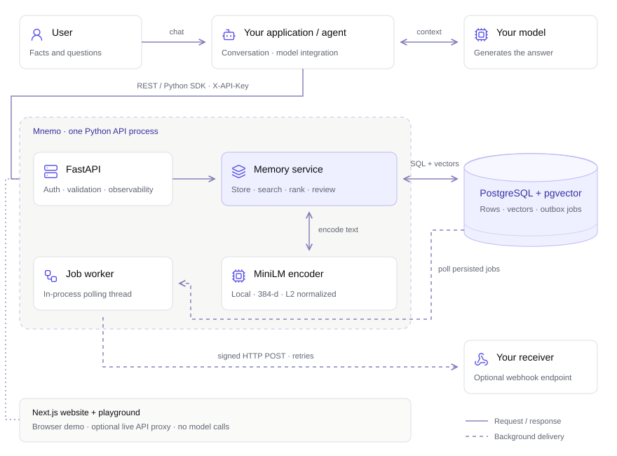

# Mnemo architecture

A deep dive into how Mnemo is built: the process layout, every table, the
scoring pipeline, and the contracts that control memory storage, retrieval and review.

## System layout

<p align="center">
<a href="assets/architecture.svg">

</a>
</p>

<p align="center">
<a href="https://trymnemo.pranavx.in/docs/concepts#architecture">Explore the interactive architecture and user flow</a> ·
<a href="assets/architecture.svg">View the full-size diagram</a>
</p>

The Next.js site is separate. Its browser simulation stays offline; the optional
live walkthrough uses a server-side proxy to call this API. Neither frontend demo
calls a generation model. The diagram shows the default local
embedding and heuristic conflict path; a configured LLM verdict provider adds
an optional external model call.


- **API process** — FastAPI, fully sync SQLAlchemy (a connection pool is
  cheaper to reason about than a sync-over-async bridge). Lifespan starts one
  `JobWorker` thread; `JOB_WORKER_ENABLED=false` disables this thread; external scheduling must then be configured explicitly.
- **Worker** — polls the outbox every second, claims one job with
  `FOR UPDATE SKIP LOCKED`, runs its handler, retries with backoff.
- **SDK** — `sdk/mnemo`: typed sync + async clients over httpx with retries
  (GETs only) and frozen dataclass models.
- **CLI** — `app/cli.py`: export/import/dump, stats, sweep-expired, jobs,
  keys, bench, doctor.

## Embeddings and indexes

- Text is embedded with `all-MiniLM-L6-v2` (384-dim, L2-normalized), so cosine
  similarity is a dot product.
- `memories.embedding` is `pgvector` with an **HNSW index** (`m=16`,
  `ef_construction=64`). Search sets `SET LOCAL hnsw.ef_search`
  (`ANN_EF_SEARCH`, default 100) inside the session transaction; the validated value is applied with PostgreSQL `set_config` in the current transaction.
- A **generated tsvector column** (`to_tsvector('english', content)`) with a
  GIN index powers the keyword half of hybrid search.
- `tags` gets a GIN index for ANY-match tag filters.

## Scoring pipeline

Search fetches an overfetch window (limit x `_SEARCH_OVERFETCH`) of the
nearest active, non-expired memories, then fuses signals in Python:

1. **Similarity** — cosine between query and memory vectors.
2. **Decay** — exponential half-life: `exp(-ln(2) * age_days / half_life)`,
   floored at `decay_floor` (global or per-namespace).
3. **Importance** — `1 + 0.05 * (importance - 3)` multiplier.
4. **Keyword fusion** — relevance is multiplied by
   `1 + keyword_weight * keyword_norm`, where `keyword_norm` is the tsvector
   match evidence for the query (pure helpers in `app/core/hybrid.py`). Zero
   weight disables the boost.
5. **MMR (optional)** — `diversity > 0` greedily re-orders candidates with
   `mmr = (1 - d) * relevance - d * max_redundancy(selected)` (pure helpers in
   `app/core/diversity.py`).

The base score is `similarity * decay * importance`. The API's returned
`relevance_score` also includes keyword boosting when enabled; MMR changes the
selection order. The browser calculator isolates the base formula. Similarity
and age are surfaced separately so callers can inspect each ranking signal.

## Contradiction detection

On every write (create **and** content update):

1. The new memory's 5 nearest neighbours are fetched
   (`_CONTRADICTION_CANDIDATES`), ignoring itself.
2. Python-owned rules in `app/core/changes.py` recognize explicit from/to
   changes to residence, favourite cuisine, learning goals and running routines.
   The subject and recorded previous value must match. These narrow English
   rules can qualify a pair below the vector gate; they never resolve it.
   A second change is compared with the latest active value.
3. Other pairs above the namespace's `contradiction_sim_threshold` (global default
   `CONTRADICTION_SIM_THRESHOLD`) go through `app/core/contradiction.py`:
   a negation-marker heuristic ("no longer", "not", "used to", ...) plus
   shared-word overlap decides `is_contradiction` with a reason.
4. **Optional LLM verdict** — `CONTRADICTION_LLM_PROVIDER=openai` asks an
   OpenAI-compatible chat model (self-hosted vLLM/Ollama work) to confirm;
   only vector-gated pairs use the model; errors or timeouts fall back to the heuristic. A configured model check
   can add latency to a write.
5. Flags are inserted with **`ON CONFLICT DO NOTHING`** against the unique
   `uq_contradictions_pair(new_memory_id, existing_memory_id)` index, so two
   workers racing on the same memory produce exactly one row — the loser's
   insert becomes a silent no-op instead of a 500 (stress-tested in
   `tests/test_concurrency.py`).
6. Audit event + webhook outbox jobs (one per active subscriber) are written
   in the same transaction.
7. **Resolution** — `POST /v1/contradictions/resolve` names a winner; the
   loser is soft-deleted and the row becomes `resolved` with
   `resolved_winner_id` set.

The API's `current_statement` is a display projection for supported changes;
`content` retains the complete source record. It does not verify a claim or
approve a conflict. The offline browser uses rule data generated from the same
Python source, with shared fixtures and a CI drift check.

## Soft delete, TTL and the sweep

Memories are soft-deleted: `is_active=false` is the tombstone, and the
audit log is append-only. Search and normal active-memory lists exclude rows
that fail either eligibility check:

- `is_active.is_(True)`
- `expires_at IS NULL OR expires_at > now()` (TTL)

`sweep_expired()` (API on startup? no — CLI `sweep-expired`, cron-friendly)
soft-deletes expired rows so counts stay honest. Search and normal lists exclude
expired memories immediately. Direct memory-by-ID reads remain available for
inspecting inactive or expired source history.

## The outbox pattern

Background work (webhook delivery) is written as a `jobs` row **inside the
same transaction as the triggering change**:

```python
audit_service.record(...)          # same transaction
webhook_service.notify_contradiction_flagged(...)   # enqueues jobs rows
db.commit()                        # change + audit + jobs land atomically
```

If the process dies after commit, the worker still delivers later; if the
transaction rolls back, nothing was ever enqueued. At-least-once delivery
uses expiring leases, stale-worker fencing, `FOR UPDATE SKIP LOCKED`, and retries
(1s, 2s, 4s, ... capped at 60s) and a terminal `failed` state after
`max_attempts`.

## Auth, keys and rate limiting

- The bootstrap key comes from `MNEMO_API_KEY` (all scopes).
- Issued keys are stored as SHA-256 hashes with an 11-char display prefix;
  scopes are `read`, `write`, `admin`; rotation replaces the secret.
- Optional exact namespace grants are checked before every memory list, search,
  write, bulk request and conflict resolution. ID routes filter allowed namespaces
  in SQL and return 404 for foreign IDs. Restricted keys cannot carry global
  admin scope; expiry is checked during authentication. NULL grants retain the
  existing unrestricted access. There is no PostgreSQL row-level security.
- Rate limiting is a **fixed-minute window in Postgres**
  (`rate_limit_counters`): one upsert per request, per-key override column on
  `api_keys`, `X-RateLimit-*`/`Retry-After` response headers. It is off by
  default (`RATE_LIMIT_ENABLED=false`) so hermetic CI cannot flake.

## Observability

- **Structured JSON logs** with a request id and duration on every line
  (`LOG_JSON=true`).
- **Prometheus metrics** hand-rolled in `app/core/metrics.py` (no client
  dependency): request counts and latency histograms by route/status.
- **Audit log** — memory and conflict mutations record actor key id, request id and
  details in the same transaction as the change (not after it).

## Pagination

Lists offer offset pagination (compat) and **cursor pagination**: an opaque
base64url token of `(created_at, id)`; the service fetches `limit + 1` rows to
detect `next_cursor`. Invalid cursors answer 400. Cursors are stable because
the sort key `(created_at DESC, id DESC)` is total.

## Data model

| Table | Purpose | Notable constraints |
|---|---|---|
| `memories` | The facts | embedding vector(384), generated tsv, GIN(tags), HNSW |
| `namespaces` | Per-namespace scoring overrides | unique name, pattern-checked |
| `api_keys` | Issued keys | unique key_hash; scopes, namespace grants and expiry |
| `rate_limit_counters` | Fixed-window counters | PK (identity, window_start) |
| `contradictions` | Flagged conflicts | unique (new_memory_id, existing_memory_id) |
| `audit_log` | Append-only trail | indexed (namespace, created_at) |
| `jobs` | Outbox queue | indexed (status, run_after) |
| `webhooks` | Subscribers | namespace + url + secret |

Migrations live in `backend/alembic/versions` (one revision per feature:
0002 tags, 0003 namespaces, 0004 api_keys, 0005 rate limiting, 0006 TTL,
0007 audit log, 0008 tsvector, 0009 HNSW, 0010 jobs, 0011 webhooks, 0012
unique pair, 0013 worker leases, 0014 key grants and expiry). CI runs `alembic upgrade head` before the test suite, so a
broken revision fails the build.

## Testing strategy

Three tiers, enforced by marks:

1. **Hermetic** (default, runs anywhere in milliseconds): pure logic — decay,
   hybrid fusion, MMR, contradiction heuristic, pagination codec, export
   formats, benchmark metrics, SDK against `httpx.MockTransport`.
2. **CI-tier** (`@requires_db`): route-level behaviour against real pgvector;
   runs in the `backend-integration` job after `alembic upgrade head`.
3. **Frontend parity**: `tests/test_frontend_parity.py` regex-parses the
   backend source for the constants the TypeScript mirror must match
   (`_CONTRADICTION_CANDIDATES`, `_SEARCH_OVERFETCH`, limits) — if the backend
   changes a constant, the frontend test fails until the mirror catches up.
